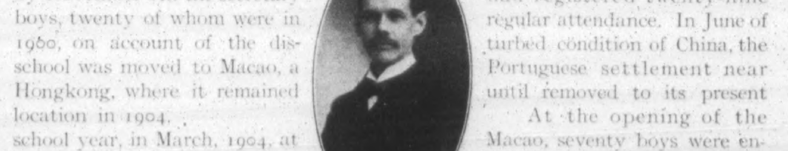

## ccc-1908 · printed p. 9 / scan p. 12
source: my-work/sources/processed/ccc-1908-p12.txt · read state: checked on the page image

[据] "In June of 1900, on account of the disturbed condition of China, the school was moved to Macao" (p. 9)
[推断] Bo (6 Nov 2026): a temporary move to Macao in 1900, not a founding in Macao.
