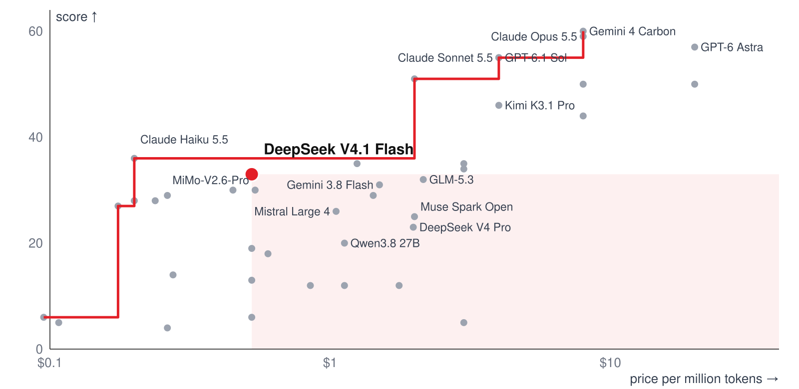
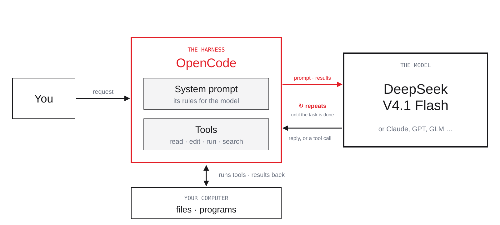
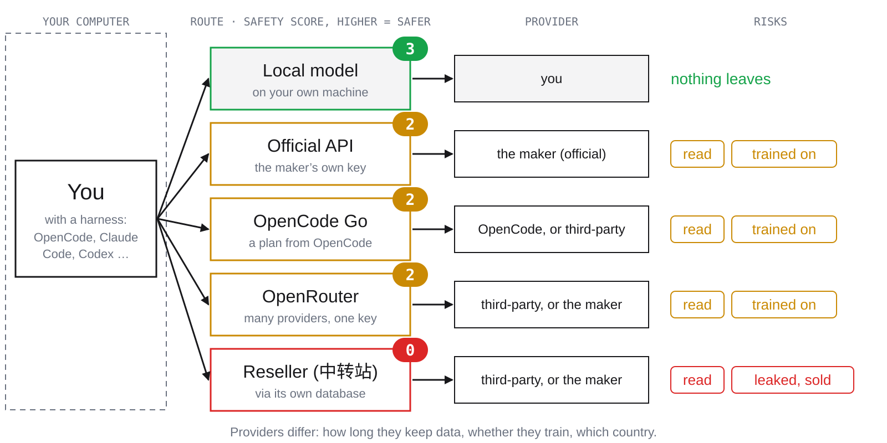
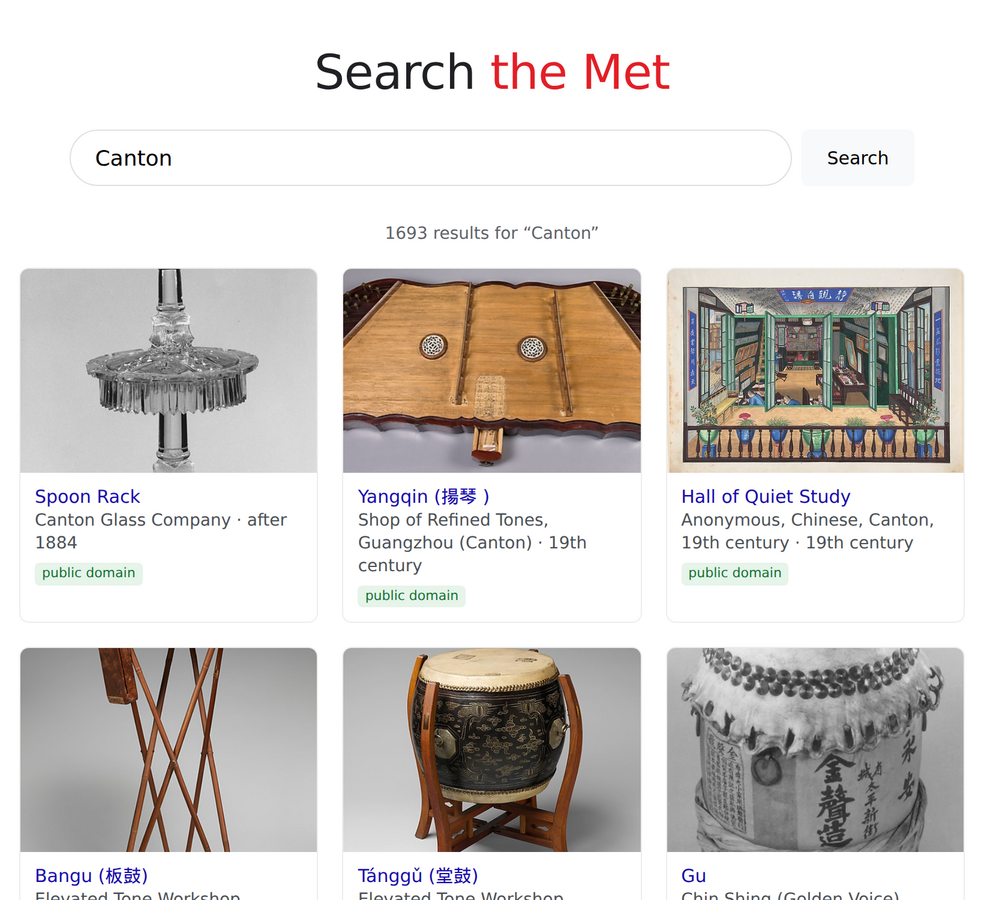
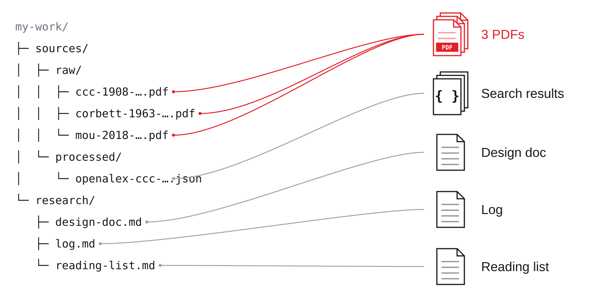
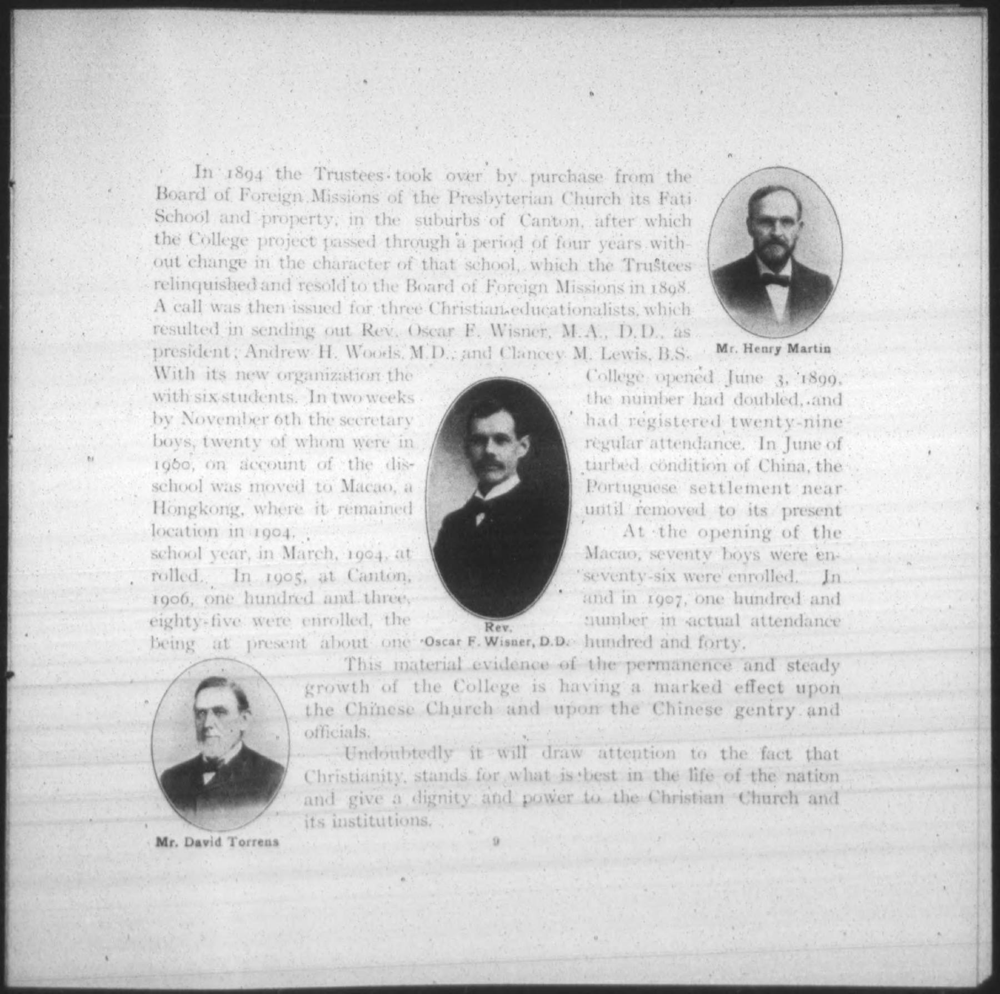
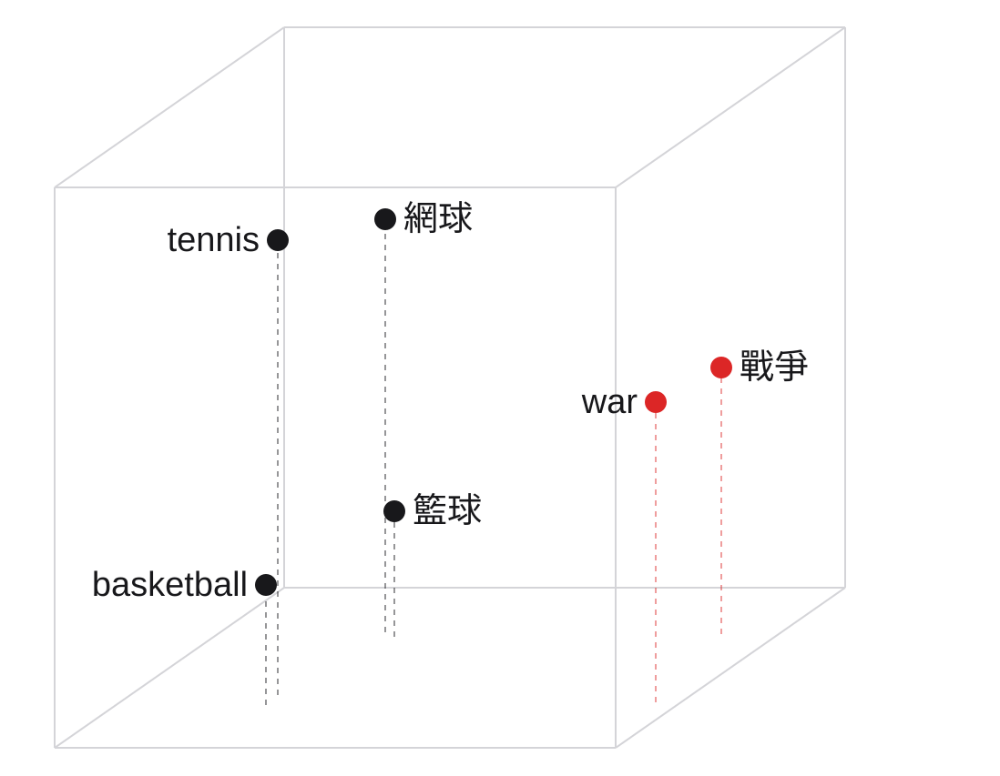
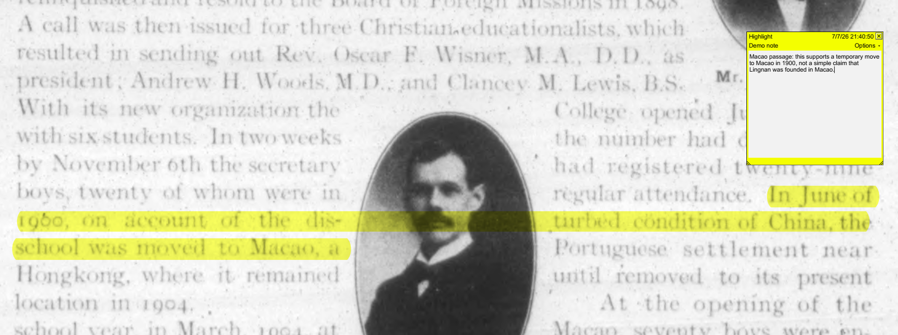

# AI & Art Research · Session One: Basic Research Workflow with LLMs

---

CUHK Fine Arts · Bo An · 6 November 2026. Agent-friendly copy of the deck: every slide in order, with its read-along text; images in images/. Public copy: no speaker notes, and images marked for classroom use only are described, not shown.

---

## 1 · Session One: Basic Research Workflow with LLMs

<!-- slide id: s01 -->

**Read-along:** Session One walks through a research workflow with large language models, through a coding agent: tools and notes, finding sources, skills, searching within sources, reading and synthesis, using the early history of Lingnan.

---

## 2 · Two sessions: today and next week.

<!-- slide id: s01b -->

**Today · Basic research workflow**

- one researcher, one coding agent
- from a first idea to a first conclusion
- the everyday workflow of a project

**Next week · Advanced workflows**

- your own database
- your own software and research tools
- verifying your claims
- more advanced methods of analysis

**Read-along:** Session 1 covers one researcher's everyday workflow with a coding agent; Session 2 builds on it with databases, software and advanced analysis.

---

## 3 · Today: six modules of one research loop.

<!-- slide id: s02 -->

**1**

**Models and harness**

models, agent, workspace

**2**

**Notes**

ideas, questions, changes

**3**

**Find sources**

web, browser, API

**4**

**Skills**

your method, saved and reused

**5**

**Search within**

OCR, images, meaning, review sheet

**6**

**Read and synthesize**

PDF annotation, notes, a conclusion

**Read-along:** Six modules form one research loop: models and harness, notes, finding sources, skills, searching within sources, and reading and synthesis. A five-minute break follows Module 2; verification comes next week.

---

## 4 · Everything you see today is in the workspace, so you can replay it.

<!-- slide id: s02b -->

**For you**

- the slides and every example file
- run each step yourself and compare
- check every result against its source

**For your agent**

- the skills and notes are instructions it can read
- point it at a folder and it can follow the same method

*Source: github.com/boan-anbo/art-ai-workshop-2026*

**Read-along:** All slides and example files are in the workspace: you can replay and check every step, and your agent can read the same files as instructions.

---

## 5 · Module 1: Models and harness.

<!-- slide id: m1-01 -->

*Models, the harness, and your workspace.*

**Read-along:** Module 1 covers the basic setup: tools, models and the workspace.

---

## 6 · Most people choose a model from a ranking like this.

<!-- slide id: m1-02 -->

| Rank | Model | Maker | Score | Context | Input | Output |
|---|---|---|---|---|---|---|
| **1** | **Gemini 4 Carbon** | **Google** | 60 | **1M** | **$4.00** | **$20.00** |
| 2 | Claude Opus 5.5 | Anthropic | 59 | 1M | $4.00 | $20.00 |
| 3 | GPT-6 Astra | OpenAI | 57 | 1M | $10.00 | $50.00 |
| 4 | GPT-6.1 Sol | OpenAI | 55 | 1M | $2.00 | $10.00 |
| 5 | Claude Sonnet 5.5 | Anthropic | 55 | 1M | $2.00 | $10.00 |
| 6 | GPT-6.1 Terra | OpenAI | 51 | 1M | $1.00 | $5.00 |
| 7 | Gemini 4 Argon | Google | 50 | 1M | $4.00 | $20.00 |
| 8 | Muse Wonder Full | Meta | 50 | 1M | — | — |
| 9 | Claude Fable 5.1 | Anthropic | 50 | 1M | $10.00 | $50.00 |
| 10 | Kimi K3.1 Pro | Kimi | 46 | 1M | $2.00 | $10.00 |

*Source: Artificial Analysis, LLM leaderboard, read 6 Nov 2026 · one row per model, at its best setting · prices in US$ per million tokens*

**Read-along:** The top ten models on the Artificial Analysis ranking of 6 November 2026, with score, context window, and input and output prices per million tokens.

---

## 7 · The model we use today is 16th, at less than a tenth of the leader's price.

<!-- slide id: m1-03 -->

**Artificial Analysis ranking**

| Rank | Model | Score | In / out |
|---|---|---|---|
| 1 | Gemini 4 Carbon | 60 | $4 / $20 |
| 2 | Opus 5.5 | 59 | $4 / $20 |
| … | | | |
| **16** | **DeepSeek Flash** | 33 | **$0.30 / $1.20** |
| 17 | GLM-5.3 | 32 | $1.40 / $4.40 |

**OpenRouter · tokens this week**

DeepSeek V4.1 Flash 101757.6T
DeepSeek V4.1 Flash16.2T
GLM 5.3 Flash15.9T
GPT-6 Luna8.95T
Hy4 preview8.1T
Claude Opus 5.56.81T
Step 5 Preview6.73T
MiniMax M3.1 Flash6.35T
GPT-5.6 Luna5.25T
GPT-6.1 Sol4.11T

*Source: Artificial Analysis, LLM leaderboard · OpenRouter rankings, tokens processed this week · both read 6 Nov 2026*

**Read-along:** DeepSeek V4.1 Flash ranks 16th with a score of 33, at $0.30 input and $1.20 output per million tokens, less than a tenth of the leader's price.

---

## 8 · DeepSeek V4.1 Flash beats 16 of 40 models: they cost more and score lower.

<!-- slide id: m1-03b -->


*Chart by the workshop from Artificial Analysis leaderboard data, read 6 Nov 2026*

*Source: Artificial Analysis leaderboard, 6 Nov 2026 · price = (3 × input + output) ÷ 4*

**Read-along:** On a chart of score against price, DeepSeek V4.1 Flash beats 16 of 40 models outright and sits at the top of the open-weights frontier: no open model is both cheaper and better. Among all models, Claude Haiku 5.5 is cheaper and slightly higher.

---

## 9 · Why DeepSeek is used so much: subscriptions and regions.

<!-- slide id: m1-03d -->

| Service | Subscription, US$ per month | Hong Kong | Mainland China |
|---|---|---|---|
| Claude | 20 – 200 | no | no |
| ChatGPT | 20 – 200 | no | no |
| Gemini | 20 – 250 | yes, but not frontier models like Argon | no |
| GLM | from 18 | yes | yes |
| **DeepSeek** | **no official plan;**
**through OpenCode Go and others** | **yes** | **yes** |

*Source: Nov 2026*

**Read-along:** Much use of Claude, ChatGPT and Gemini runs through subscriptions that OpenRouter does not see, and those services are restricted in Hong Kong and mainland China; DeepSeek has no official subscription but is offered through third-party plans such as OpenCode Go, and works in both.

---

## 10 · For writing and knowledge: Text Arena.

<!-- slide id: m1-03c -->

Gemini 4 Carbon1528
Gemini 4 Argon1520
Claude Opus 5.51509
Muse Wonder1507
Claude Fable 5.11504
Claude Fable 51504
Claude Opus 4.61503
Claude Opus 4.71501
Gemini 3.8 Flash1496
Muse Spark 1.31495

*Source: LMArena Text, 28 Oct 2026*

**Read-along:** On LMArena Text, where people compare two anonymous answers, Google, Anthropic and Meta lead the ranking.

---

## 11 · The card of the model we use: DeepSeek V4.1 Flash 1017.

<!-- slide id: m1-04 -->

**Maker**

**DeepSeek**

**Generation**

**V4.1**

**Tier**

**Flash**

*small, fast; a newer Flash beats an older Pro (33 vs 23)*

**Release**

**1017**

**Score**

**33**

*a composite of tests: knowledge, reasoning, maths, coding*

**Context**

**1M tokens**

*how much it sees at once*

**Input**

**$0.30 / 1M**

*per million tokens; a token is a piece of text*

**Output**

**$1.20 / 1M**

*writing costs 4× reading*

**Cached input**

**$0.01 / 1M**

**Speed**

**173 tokens/s**

**First answer**

**≈ 52 s at max**

*at max thinking; non-reasoning answers in ~1 s*

**Weights**

**open · MIT**

*anyone may run it*

*Source: Artificial Analysis, model page and leaderboard, read 6 Nov 2026 · tested at max thinking*

**Read-along:** The full card of DeepSeek V4.1 Flash 1017: maker, generation, tier, release, score, context, input, output and cached prices, speed, time to first answer, and open weights.

---

## 12 · Price is per million tokens; writing costs more than reading.

<!-- slide id: m1-08 -->

Model: DeepSeek V4.1 Flash · Tier: Flash · Score: 33 · Input · per million tokens: $0.30 · Output · per million tokens: $1.20 · Thinking: max · Context: 1 million tokens · Weights: open · 

**The task**

- read a 300-page book: about 160,000 tokens
- write a 5-page summary: about 4,000 tokens

| | DeepSeek V4.1 Flash | Gemini 4 Carbon |
|---|---|---|
| Reading, per million tokens | $0.30 | $4 |
| Writing, per million tokens | $1.20 | $20 |
| Read the book | $0.048 | $0.64 |
| Write the summary | $0.005 | $0.08 |
| **The task** | **about $0.05** | **about $0.72** |

*Source: Artificial Analysis, read 6 Nov 2026*

**Read-along:** Reading a 300-page book and writing a 5-page summary costs about $0.05 with DeepSeek V4.1 Flash and about $0.72 with the leading model, Gemini 4 Carbon; thinking tokens are charged as writing.

---

## 13 · Context window: what the model sees at once.

<!-- slide id: m1-10 -->

Model: DeepSeek V4.1 Flash · Tier: Flash · Score: 33 · Input · per million tokens: $0.30 · Output · per million tokens: $1.20 · Thinking: max · Context: 1 million tokens · Weights: open · 

**What counts**

- your instructions
- the files
- earlier turns and tool results

**Found, by length of input**

4–8K97.3%
8–16K91.4%
16–32K97.2%
32–64K90.5%
64–128K86.0%
128–256K79.3%
256–512K57.5%
512K–1M36.6%

*Source: GPT-5.4, OpenAI MRCR v2 (8 needles), March 2026 · tokens of material · % found*

**Read-along:** The context window is everything the model sees at once, one million tokens here. In OpenAI's long-context test, GPT-5.4 finds 90% or more of what it is asked for in short material but only 37% near one million tokens; give selected, numbered excerpts instead.

---

## 14 · One model, many providers: 38 on OpenRouter.

<!-- slide id: m1-10b -->

Model: DeepSeek V4.1 Flash · Tier: Flash · Score: 33 · Input · per million tokens: $0.30 · Output · per million tokens: $1.20 · Thinking: max · Context: 1 million tokens · Weights: open · 

| Provider | Input, per million tokens | Output, per million tokens | Precision |
|---|---|---|---|
| **Relace** | **$0.006** | **$0.50** | **fp4** |
| DeepInfra | $0.112 | $0.336 | fp8 |
| Baidu | $0.13 | $0.52 | fp8 |
| Google | $0.30 | $1.20 | — |
| Together | $0.30 | $1.20 | — |

*Source: openrouter.ai, DeepSeek V4.1 Flash endpoints, read 6 Nov 2026*

**Read-along:** Because DeepSeek published the weights, 38 providers run the same model on OpenRouter, at different prices and precisions, and with different data policies.

---

## 15 · A paradigm shift: from chat to agent.

<!-- slide id: m1-13 -->

**Chat**

*[Image left out of the public copy: A Gemini chat: a pasted paragraph with spelling mistakes, and the corrected version returned as text.]*

*OpenCode · art-ai-workshop-2026*

```text
@my-work/research/lingnan-note.md
Please proofread this note.

← Edit my-work/research/lingnan-note.md
- Lingnan begun as Canton Christian Collage in 1888.
+ Lingnan began as Canton Christian College in 1888.
- In June 1900 the school were moved to Macao,
+ In June 1900 the school was moved to Macao,
Four fixes, no wording changed.
```

**Read-along:** A chat returns corrected text that you copy back by hand; an agent opens the file, edits it and saves it.

---

## 16 · What is a harness? The program between you, the model and your computer.

<!-- slide id: m1-24 -->


*Diagram by the workshop*

**Read-along:** The model only reads and writes text. OpenCode, the harness, gives it tools on your computer: reading, editing and writing files, running commands, searching the web, and asking your permission.

---

## 17 · Several harnesses do the same job, with different models and rules.

<!-- slide id: m1-24b -->

| Harness | Maker | Models | Open | You pay | Our view |
|---|---|---|---|---|---|
| **Pi** | **M. Zechner** | **almost any** | **yes** | **the provider** | **most flexible; harder** |
| **OpenCode** | **Anomaly** | **almost any** | **yes** | **provider, or Go** | **used today** |
| DeepSeek Harness | DeepSeek | mostly DeepSeek | yes | the DeepSeek API | promising; growing fast |
| Claude Code | Anthropic | Claude | no | plan or API | |
| Codex CLI | OpenAI | GPT | yes | plan or API | |
| Antigravity CLI | Google | Gemini | no | plan | |
| WorkBuddy | Tencent | Hy, DeepSeek … | no | free; Pro $10 | not recommended |

*Source: Makers' sites and documentation, Nov 2026*

**Read-along:** Pi, OpenCode, Claude Code, Codex CLI and Antigravity CLI all let a model work on your files; they differ in models, price and their own instructions to the model. Pi is the most flexible; DeepSeek Harness is new and growing fast; today we use OpenCode.

---

## 18 · Underneath: we give the model a tool, it asks for it, OpenCode runs it.

<!-- slide id: m1-25 -->

*Question: 光緒二十六年是公元哪一年？*

**1 · The tool we give it**

`dynasty_years`

turns a reign year into Western dates

**2 · The model asks for it**

`dynasty_years`

era 光緒, year 26

**3 · OpenCode runs it**

31 Jan 1900 – 18 Feb 1901

the model answers: mostly 1900

*Source: Example from the DH guide, "What is an agent?", with the DILA Authority Database*

**Read-along:** Tool calling: we give the model a tool (here dynasty_years, which turns a reign year into Western dates); the model asks for it with the reign and year; OpenCode runs it and returns a small JSON result; the model answers from that result.

---

## 19 · Programmers now direct agents; for scholars the stakes are higher.

<!-- slide id: m1-23 -->

**Programmers**

- describe the task; the agent writes the code
- many no longer read every line
- tests catch mistakes; they can iterate

**Scholars**

- the agent may silently rewrite a sentence
- one misquoted line is misconduct
- so we borrow their tests and verification

**Read-along:** For scholars the risk is higher than for programmers: an agent can silently change a quotation while editing, and one misquoted line is misconduct. We borrow programmers' habits of testing and verification.

---

## 20 · A model is intelligence, not a knowledge base.

<!-- slide id: m6-hall -->

*[Image left out of the public copy: Without search, even the best AI models get 1 in 4 answers wrong: Claude Opus 5.5 and GPT-6 Astra 23%, down to MiMo-V2.6-Pro 43%.]*

**For us, as academics**

- AI that can tackle Fields-Medal-level maths still gets basic facts wrong
- it remembers only roughly: intelligence, not a knowledge base
- so give it knowledge: your sources, databases it can query
- and guardrails: another agent checks its work
- that is how we deal with our biggest fear: making things up

*Source: Artificial Analysis Intelligence Index v4.3 (AA-Omniscience), 29 Sep 2026 · chart: Randal S. Olson*

**Read-along:** A model is intelligence, not a knowledge base: without search, even the best models get about one in four specific facts wrong. Pair it with your own data and set guardrails around it, and only then is it a tool for scholarship.

---

## 21 · OpenCode comes as a desktop app and as a terminal program; we use the terminal.

<!-- slide id: m1-17b -->

**Desktop app**

- a window like any other app
- easiest to install on Windows
- fine to use; catching up

**Terminal · recommended**

- the full and fastest version
- opens inside any folder
- on Windows, install WSL first: well worth it

**Read-along:** OpenCode comes as a desktop app and as a terminal program. The terminal version is the fullest and fastest; on Windows it needs WSL first, which is worth the effort. The desktop app is fine too.

---

## 22 · Open OpenCode inside the workspace.

<!-- slide id: m1-17 -->

*Terminal*

```text
$ cd art-ai-workshop-2026
$ opencode
```

*OpenCode · art-ai-workshop-2026*

```text
     █▀▀█ █▀▀█ █▀▀█ █▀▀▄ █▀▀▀ █▀▀█ █▀▀▄ █▀▀█
     █  █ █  █ █▀▀▀ █  █ █    █  █ █  █ █▀▀▀
     ▀▀▀▀ █▀▀▀ ▀▀▀▀ ▀▀▀▀ ▀▀▀▀ ▀▀▀▀ ▀▀▀  ▀▀▀▀
```

*Desktop app: open the workspace folder from the app.*

**Read-along:** Opened inside the workspace, OpenCode shows one input box and, under it, the agent, the model, the plan and the thinking tier.

---

## 23 · Your workspace is one folder, downloaded from GitHub.

<!-- slide id: m1-15 -->

**art-ai-workshop-2026/**

```text
├─ .opencode/skills/   skills
├─ AGENTS.md           rules for the agent
├─ README.md
├─ my-work/            your project:
│  ├─ sources/raw/        originals, never edited
│  ├─ sources/processed/  crops, OCR, tables
│  ├─ research/           design doc, log, notes
│  └─ artifacts/          large outputs, not in Git
├─ session-01/
├─ session-02/
└─ …
```

**From GitHub**

- `github.com/boan-anbo/art-ai-workshop-2026`
- Download once; today we work inside it

**Read-along:** Your workspace is one folder. Download `github.com/boan-anbo/art-ai-workshop-2026` once; everything we do today happens inside it.

---

## 24 · OpenCode Go: $10 a month buys $100 of DeepSeek V4.1 Flash.

<!-- slide id: m1-29 -->

*Every five hours you may use 20% of the monthly limit; off-peak hours cost half.*

| Model | Monthly limit, Go ($10) | Requests per 5 hours | Requests per month |
|---|---|---|---|
| **DeepSeek V4.1 Flash** | **$100** | **43,330** | **216,670** |
| GLM-5.3-Flash | $60 | 6,320 | 31,580 |
| DeepSeek V4 Pro | $15 | 1,050 | 5,200 |
| Kimi K3 | $15 | 110 | 490 |

*Source: opencode.ai/docs/go, read 6 Nov 2026 · Go Plus ($40/month) has higher limits*

**Read-along:** OpenCode Go costs $10 a month (Go Plus $40), with request allowances per five hours that vary by model: 43,330 for DeepSeek V4.1 Flash, 110 for Kimi K3.

---

## 25 · Get your key, connect, choose the model.

<!-- slide id: m1-28a -->

**1 · opencode.ai → Console, sign in**

*[Image left out of the public copy: opencode.ai home page with the Console link marked.]*

**2 · Account → Add API key**

*[Image left out of the public copy: Personal API keys with the Add API key button marked; key values removed.]*

*3 · /connect*

```text
Connect a provider
OpenCode Go

API key
oc_sk_••••••••
```

*4 · /models*

```text
Select model
● DeepSeek V4.1 Flash   OpenCode Go
  GLM-5.3               OpenCode Go
  Kimi K3               OpenCode Go
```

*Source: opencode.ai, 6 Nov 2026 · key values removed*

**Read-along:** Open opencode.ai, go to the Console and sign in; under Account, add an API key and copy it; in OpenCode type /connect, choose OpenCode Go and paste the key; then type /models and choose DeepSeek V4.1 Flash. Keep the key private.

---

## 26 · Type @ and part of a name; OpenCode finds the file.

<!-- slide id: m1-26 -->

*OpenCode · art-ai-workshop-2026*

```text
my-work/research/lingnan-note.md
my-work/self-introduction.example.md
site/src/components/QuestionAnswers.astro
```

> typed: @lingnan

**Read-along:** Type @ and part of a file name; OpenCode lists matching files in the workspace, so the agent reads exactly the one you choose.

---

## 27 · Proofreading: a note with mistakes, one sentence, the file fixed.

<!-- slide id: m1-18 -->

*1 · lingnan-note.md*

```text
Lingnan begun as Canton
Christian Collage in 1888.
In June 1900 the school
were moved to Macao,
and it move back to
Canton in 1904.
```

*2 · OpenCode*

```text
@my-work/research/
lingnan-note.md
Please proofread this note.
Fix spelling and grammar only.

+ Thought · 0.3s
→ Explored: 1 read
```

*3 · ← Edit*

```text
- begun    + began
- Collage  + College
- were     + was
- move     + moved

Four fixes, no wording
changed.
▣ DeepSeek V4.1 Flash · 9.8s
```

**Read-along:** A note with four mistakes; one sentence asks OpenCode to fix spelling and grammar only; it edits the file in place, shows the four changes, and changes no wording.

---

## 28 · Where the training data comes from: nearly everything that can be read.

<!-- slide id: m1-train -->

- **Web**: 1 trillion pages, crawled at about 10 billion a day
- **Documents**: 2 billion scientific PDFs, read by OCR
- **Books**: 50 million books, layout reordered, garbled text filtered
- **Code**: 500 million repositories, turned into tasks with real tests
- **Video**: 10 billion videos
- **Audio**: 300 million hours, transcribed into trillions of tokens

**Read-along:** A frontier model is trained on nearly everything that can be read: about a trillion web pages, two billion scientific PDFs, fifty million books, half a billion code repositories, ten billion videos and three hundred million hours of audio.

---

## 29 · Privacy: no one can guarantee your data or your research ideas are safe.

<!-- slide id: p-00 -->

- but knowing where your data goes lowers the risk
- every step it passes through can be made safer

**Read-along:** No one can guarantee that your data or your research ideas are safe. But knowing where your data goes, and making each step safer, lowers the risk.

---

## 30 · Where your data goes, from safest to riskiest.

<!-- slide id: p-01 -->


*Diagram by the workshop*

**Read-along:** Your data goes by one of five routes to a provider, the company that runs the model. A local model is safest: nothing leaves. The official API, OpenCode Go and OpenRouter rate the same: your content may be read and is likely to be used for training. A reseller is the least safe: your data passes through its own database and may be leaked or sold, though not necessarily trained on.

---

## 31 · Where it goes, what can happen, what you can do.

<!-- slide id: p-02 -->

| Where | What it can see or keep | What you can do |
|---|---|---|
| Your harness | your files; logs on your disk | no keys or passwords in files; read others' skills first |
| Official API, OpenCode Go, OpenRouter | the route and the provider; kept 0–30 days; may train | opt out of training; check each provider's retention and region |
| Reseller (中转站) | everything passes through its own database; many are known to sell it | avoid it |
| Local model | nothing leaves | costs money and power (see next) |

*Source: OpenCode Go: requests stay in Europe and the US by default; DeepSeek needs region "Global" (Settings › Privacy), so data may go to servers in China.*

**Read-along:** Each step carries its own risk: the harness keeps logs on your disk; a reseller sees everything and may keep or resell it; a router passes your requests on; providers keep data for up to 30 days and may train on it. Opt out of training, check retention and regions, avoid resellers, and use a local model for the most sensitive material.

---

## 32 · Two recent cases: what you send may be read, kept, or learned from.

<!-- slide id: m1-30b -->

**OpenAI · Sept–Oct 2026**

- mathematicians say its new proofs drew on their unpublished work and their ChatGPT and Codex sessions
- OpenAI denies it, but cannot rule out that de-identified user data improved its models

**Anthropic · Sept 2026**

- its public threat report described what users had sent to Claude
- including sensitive details about another company's customers

*Allegations and reports, not settled findings; the lesson holds either way.*

*Source: Scientific American; Futurism; Anthropic, "Countering misuse of AI: September 2026"*

**Read-along:** Two recent cases: mathematicians allege that OpenAI's announced proofs drew on their unpublished work and chat sessions, which OpenAI denies; Anthropic's public threat report described the content users had sent to Claude. What you send may be read, kept or learned from.

---

## 33 · Privacy checklist: what you can do.

<!-- slide id: m1-31 -->

**Route**

- never a reseller (中转站)
- the official API where you can
- strictly confidential: a local model, or the university's own service

**Settings**

- “help improve our models”: off
- “share your data?”: no

**Habits**

- nothing private in a conversation: names, keys, passwords
- clean up local logs, or keep them somewhere safe

**Read-along:** Never use a reseller, and prefer the official API. Turn off "help improve our models" and decline to share your data. Keep names, keys and passwords out of conversations, and clean up or safely store local logs. For strictly confidential material, use a local model or the university's own service.

---

## 34 · A local model: nothing leaves, but it is not yet practical.

<!-- slide id: m1-31b -->

- capable open-weight models need hardware of HK$100,000 or more
- then each run costs almost nothing; through an API it is cheap to start
- open-weight models now reach about last year's frontier, but the largest are hard to host

*My estimate: two to three years before the intelligence we need runs on our own machines.*

**Read-along:** A local model is the only full protection, since nothing leaves your machine, but it is not yet practical: capable open-weight models need hardware of HK$100,000 or more, and the largest are hard to host. Bo's estimate: two to three years before the intelligence we need runs locally.

---

## 35 · Your questions, Module 1: Models and harness.

<!-- slide id: qa-1 -->

| | Your question | Short answer |
|---|---|---|
| 05.2 | 如何為圖像研究選擇模型？ | Start from a ranking, the price and the context window; then test on ten of your own images. Module 5 compares OCR and vision models on one line. |
| — | 我的材料會不會外洩？ | No route can guarantee it. Only a local model keeps it on your computer; official APIs and routers may read and train on it; resellers leak it. Use the checklist. |

**Read-along:** The participants' questions for Module 1, each with a short answer drawn from the slides before.

---

## 36 · Any questions?

<!-- slide id: q-1 -->

*Module 1: Models and harness.*

**Read-along:** End of Module 1. Questions are welcome now or after the session.

---

## 37 · Module 2: Notes.

<!-- slide id: m2-01 -->

*Ideas, questions, and how they change.*

**Read-along:** Module 2 shows how to keep notes that grow with the project: a design doc, a log, and plain-text Markdown.

---

## 38 · Keep two kinds of document: a design doc and a log.

<!-- slide id: m2-02 -->

**Design doc**

- where the project stands now
- rewritten as you go

**Log**

- what happened, by date
- only ever added to

**Read-along:** Keep two kinds of document: a design doc that describes where the project stands now and is rewritten as it changes, and a log that records what happened by date and is only added to.

---

## 39 · Ask OpenCode to create the design doc.

<!-- slide id: m2-03 -->

*OpenCode · art-ai-workshop-2026*

```text
Create my-work/research/design-doc.md for my Lingnan project.
Question: Lingnan's beginnings, 1888–1904: where did it begin,
and what did it teach? Add sources so far and next steps. Keep it short.

← Write my-work/research/design-doc.md

Created my-work/research/design-doc.md.
I deliberately did not add historical facts beyond your note.
▣ Build · DeepSeek V4.1 Flash · 28.4s
```

**Read-along:** OpenCode can create the project's design doc from one instruction: the question, the sources so far, and the next steps. The result is a file in the workspace, not a message in a chat.

---

## 40 · Markdown is plain text with a few marks.

<!-- slide id: m2-04 -->

*my-work/research/design-doc.md*

```text
# Design Doc — Lingnan Project

## Question
Lingnan's beginnings, 1888–1904:
where did it begin, and what did it teach?

## Sources so far
- lingnan-note.md: three dates, no citation yet — unverified

## Next steps
1. Verify the dates against one primary source.
2. Start a log of every search.
```

**Read-along:** A design doc is a Markdown file: a heading, a question, the sources so far, and the next step. It stays readable as plain text in any editor.

---

## 41 · Seven marks cover almost everything.

<!-- slide id: m2-05 -->

*You type*

```text
# Lingnan's beginnings
## Sources
- memoir, 1954
1. read the 1908 booklet
the college opened in **1899**
see [Digital Commons](https://commons.ln.edu.hk)
> the school was moved to Macao
open `log.md`
```

**You get**

### Lingnan's beginnings

#### Sources

- memoir, 1954

1. read the 1908 booklet

the college opened in **1899**

see [Digital Commons](https://commons.ln.edu.hk)

> the school was moved to Macao

open `log.md`

**The seven marks**

- `#` `##` heading
- `-` list
- `1.` numbered list
- `**…**` bold
- `[text](link)` link
- `>` quotation
- `` `…` `` code, file name

*Source: [markdownguide.org/cheat-sheet](https://www.markdownguide.org/cheat-sheet/)*

**Read-along:** Seven Markdown marks cover most notes: # and ## for headings, - for a list, 1. for a numbered list, ** for bold, [text](link) for a link, > for a quotation and backticks for code. The full syntax is on the Markdown Guide cheat sheet.

---

## 42 · Plain text is future-proof.

<!-- slide id: m2-06 -->

**Word**

.docx

- a packaged file, read through Word
- layout and text mixed together
- an agent must convert it first

**Notion**

notion.so

- kept on Notion's servers
- export goes through them
- an agent needs their login to read it

**Markdown**

.md

- plain text, on your disk
- opens in any editor, for decades
- an agent reads and edits it directly

**LaTeX**

.tex

- plain text with commands
- for papers and books
- next week

**Read-along:** Word packages layout and text together and needs conversion; Notion keeps your notes on its servers; Markdown is plain text on your disk that any editor and any agent can read; LaTeX is plain text with commands, for papers, next week.

---

## 43 · "Where did Lingnan begin?" Two answers disagree.

<!-- slide id: m2-08 -->

**Google · AI Overview**

*[Image left out of the public copy: Google AI Overview answering that Lingnan University was founded in Guangzhou in 1888, moved to Macau in 1900 and returned in 1904.]*

**敖士洲 · memoir manuscript**

*[Image left out of the public copy: Manuscript column: 本校在此國情之際，大抵於一八九九年開始租屋創辦於澳門 — the school was probably founded in rented premises in Macao around 1899.]*

*Source: Left: a fast AI answer, Guangzhou 1888. Right: a memoir written in 1954, Macao, c. 1899.*

**Read-along:** A quick AI answer says Lingnan began in Guangzhou in 1888; a memoir written in 1954 says it began in rented rooms in Macao around 1899. Neither settles the question, so we look for the earliest original.

---

## 44 · Write it down: tell OpenCode what you found and what comes next.

<!-- slide id: m2-10 -->

*Tip: dictate instead of typing; voice input is much faster for instructions.*

*OpenCode · art-ai-workshop-2026*

```text
I searched quickly myself. An AI answer says Guangzhou, 1888;
a 1954 memoir says Macao, c. 1899. Add this to my log, and note
what I want next: more sources, starting with the 1908 booklet.

← Edit my-work/research/log.md
Added today's entry: question, findings, next step.
▣ Build · DeepSeek V4.1 Flash
```

*my-work/research/log.md*

```text
## 6 Nov 2026
Question: where did Lingnan begin? (first half)
Found: an AI answer (Guangzhou, 1888) and a 1954
       memoir (Macao, c. 1899) disagree.
Next: more sources, starting with the
      1908 college booklet.
```

**Read-along:** Tell OpenCode what you found and what you want next; it appends a dated entry to the log: the question, the two disagreeing answers, and the next step, the 1908 college booklet.

---

## 45 · Your questions, Module 2: Notes.

<!-- slide id: qa-2 -->

| | Your question | Short answer |
|---|---|---|
| 01.3 | 如何組織筆記與反思性寫作？ | Keep notes in plain text: quick to search, always saved, never locked in, no version trouble. A design doc you rewrite, a log you add to. Edit them in VS Code or Obsidian. |
| 11.1 | 如何用 AI 協助構思與檢驗新想法？ | Talk with it and let it write your notes. More in later modules. |

**Read-along:** The participants' questions for Module 2, each with a short answer drawn from the slides before.

---

## 46 · Any questions?

<!-- slide id: q-2 -->

*Module 2: Notes.*

**Read-along:** End of Module 2. Questions are welcome now or after the session.

---

## 47 · Break: five minutes.

<!-- slide id: break -->

*Then Module 3: Search for sources.*

---

## 48 · Module 3: Search for sources.

<!-- slide id: m3-01 -->

*Web search, browsers, APIs and downloads.*

**Read-along:** Module 3 asks whether AI can find everything and how to collect sources from databases and archives. It answers questions 07.2 and 02.3.

---

## 49 · Match the search to the source.

<!-- slide id: m3-01b -->

- **A quick question**: built-in web search: fast, open web only
- **OpenAlex**: a scholarly index of many publishers: its API
- **Google Scholar**: the core for most of us, but no API: you search, or a third-party API
- **A collection with an API**: the Met, its own database: its API
- **A site made for people**: no API, only a search box: a browser

**Read-along:** Choose the search by the source: built-in web search for a quick question; an API for a scholarly index such as OpenAlex or a collection such as the Met; Google Scholar by hand or through a third-party API; a browser for a site made only for people.

---

## 50 · Built-in web search: fine for a quick question, not for research.

<!-- slide id: m3-02 -->

*OpenCode · art-ai-workshop-2026*

```text
Find one early primary source on when and where Lingnan was founded.

Web Search
Allow OpenCode to search the web for up-to-date information?
1. Allow search via Exa, Firecrawl, Parallel, Tavily, TinyFish

   → Explored: 2 searches
   → Explored: 2 fetches
   → Explored: 1 fetch, 1 search
   … 3 minutes, 130K tokens, no source settled
```

**It sees only part**

- no catalogues or databases behind a login
- weak on old and Chinese names
- **no record of where it looked**

**Read-along:** OpenCode can search the web by itself, which is fine for a quick question. But it cannot reach catalogues behind a login, is weak on old and Chinese names, and keeps no record of where it looked.

---

## 51 · An API: the same OpenAlex search, for people and for programs.

<!-- slide id: m3-04 -->

**Browser · made for people**

*[Image left out of the public copy: openalex.org search results for Canton Christian College.]*

**API · made for programs**

*[Image left out of the public copy: The same search from the OpenAlex API, as JSON.]*

*Source: The same search in OpenAlex, 6 Nov 2026: 147 works*

**Read-along:** A browser route lets the agent see what you see after login; an API asks a database directly and returns data in fixed fields.

---

## 52 · Let the agent use the API, with your own free key.

<!-- slide id: m3-05b -->

**1 · The website: “use our API”**

*[Image left out of the public copy: OpenAlex page: Looks like you're a bot — please use our free API instead. Free key, own $1/day budget.]*

*2 · The API without a key: throttled*

```text
{
  "error": "Rate limit exceeded",
  "message": "Anonymous search is temporarily
    rate-limited while the search cluster is under
    elevated load. Please retry in 36s, or use a
    free API key for uninterrupted access."
}
```

*Source: Both captured on 6 Nov 2026 · free key: openalex.org/settings/api*

**Read-along:** The OpenAlex website sends agents to its API, and the API without a key can be throttled at busy times. Let the agent use the API with your own free key.

---

## 53 · Agents are fluent with APIs: if a source has one, tell the agent to use it.

<!-- slide id: m3-05c -->

**Why an API**

- built for programs, so agents read it easily
- exact fields: title, year, author, link
- the same request gives the same answer

**Get a key**

- most APIs need one, like OpenCode Go
- OpenAlex: free key, $1 of searches a day
- without a key: $0.10 a day, shared

*Source: help.openalex.org/access/pricing, read 6 Nov 2026 · key: openalex.org/settings/api*

**Read-along:** Agents use APIs fluently, so if a source has an API, ask the agent to use it. Most APIs need a key: OpenAlex gives a free key with $1 of searches a day; without one there is $0.10 a day, shared.

---

## 54 · Ask OpenCode to query OpenAlex for you.

<!-- slide id: m3-06 -->

*OpenCode · art-ai-workshop-2026*

```text
Search OpenAlex for "Canton Christian College curriculum" with curl
and save the first ten results to my-work/sources/processed/.

$ curl -s "https://api.openalex.org/works?search=Canton+Christian
+College+curriculum&per-page=10" -o openalex-ccc-curriculum.json

Saved: my-work/sources/processed/openalex-ccc-curriculum.json
Matches: 2,071
▣ Build · DeepSeek V4.1 Flash · 1m 32s
```

**Read-along:** OpenCode sends the OpenAlex query with curl and saves the first ten results as JSON; tonight the index reported 2,071 matches.

---

## 55 · What comes back is data, and the first hit can be irrelevant.

<!-- slide id: m3-07 -->

*api.openalex.org/works?search=Canton+Christian+College+curriculum*

```text
{
  "meta": { "count": 2071 },
  "results": [
    { "title": "The Development of a Program in Humanities
               for the Junior College Curriculum",
      "publication_year": 1961,
      "id": "https://openalex.org/W289137080" },
    …
  ]
}
```

**Read-along:** The JSON reports 2,071 matches, and the first is a 1961 junior-college humanities study: data, not yet a relevant source.

---

## 56 · The same works for museums: the Met's API, searched for "Canton".

<!-- slide id: m3-05d -->

*collectionapi.metmuseum.org/public/collection/v1.1/search?q=Canton&hasImages=true*

```text
{ "total": 1693,
  "objectIDs": [7859, 500595, 387080, …] }

/objects/7859   Spoon Rack · Canton Glass Company
                "city": "Canton", "country": "United States"

/objects/500595
{ "title": "Yangqin (揚琴)",
  "artistDisplayName": "Shop of Refined Tones, Guangzhou (Canton)",
  "city": "Canton", "country": "China",
  "objectDate": "19th century",
  "isPublicDomain": true }
```

**Yangqin, Guangzhou (Canton), 19th century**


*Yangqin, Shop of Refined Tones, Guangzhou (Canton), 19th century. The Metropolitan Museum of Art, The Crosby Brown Collection of Musical Instruments, 1889 (Open Access, CC0)*

*Source: The Met Collection API, called 6 Nov 2026 · also: Art Institute of Chicago API (api.artic.edu)*

**Read-along:** Museum collections have APIs too. Searching the Met's API for "Canton" returns 1,693 works with images; the first is from Canton, Ohio, the second a 19th-century yangqin made in Guangzhou, with its maker, city, date and public-domain status in fixed fields.

---

## 57 · On top of an API, the agent can build you a small search engine.

<!-- slide id: m3-05e -->

*OpenCode · art-ai-workshop-2026*

```text
Make a simple Google-style search page for the Met
Collection API: one search box; for each result show
the image, title, artist, date, and public domain.

← Write session-01/examples/met-search/index.html
Open it in your browser and type a search.
▣ Build · DeepSeek V4.1 Flash
```

**session-01/examples/met-search/**


*Page built for the workshop on the Met Collection API; images: The Metropolitan Museum of Art, Open Access*

**Read-along:** On top of an API, the agent can build a small search page of your own: one sentence describes it, and the page fetches results from the Met's API and previews them, with image, title, artist, date and rights.

---

## 58 · Google Scholar has no API: you search, or use a third-party one.

<!-- slide id: m3-09 -->

*Third-party APIs such as Serper work, but Google does not allow them. Here the agent suggests the queries.*

*OpenCode · art-ai-workshop-2026*

```text
I will search Google Scholar and Baidu myself. Suggest five queries
for each, in English and Chinese, for: what did early Lingnan teach?

+ Thought · 5.4s
Google Scholar (English)
1. "Canton Christian College" curriculum 1888 1904
3. Happer "Christian College" Canton secular curriculum English Chinese classics
Baidu (Chinese)
1. 岭南大学 前身 格致书院 课程 1888
3. 岭南学堂 1904 康乐 学制 课程
▣ Build · DeepSeek V4.1 Flash · 8.2s
```

**Read-along:** Google Scholar, Bing and Baidu do not allow automated searching, so you search them; the agent suggests queries in English and Chinese, including old names such as 格致书院.

---

## 59 · Give the agent a browser: a Chrome MCP, or agent-browser.

<!-- slide id: m3-10 -->

*It can click “buy” or “send” as easily as “search”: never give it your passwords.*

**Chrome DevTools MCP**

- drives your own Chrome
- sees what you see, logged in
- ask the agent to set it up

**agent-browser**

- a browser made for agents
- already in the workspace
- installed as a skill

**You**

- log in, solve CAPTCHAs
- approve each action
- keep private pages closed

**Read-along:** An agent can use a browser through a Chrome DevTools MCP (your own Chrome) or a browser made for agents (agent-browser). It can click "buy" or "send" as easily as "search": you log in, approve its actions, and never give it your passwords.

---

## 60 · The agent turns the data into a reading list you can check.

<!-- slide id: m3-08 -->

*my-work/research/reading-list.md*

```text
| Year | Author   | Title                                              |
|------|----------|----------------------------------------------------|
| 2008 | Barwick  | Faith, Identity, and Nationalism … Christian Colleges |
| 2018 | Mou      | The Liberal Arts Curriculum in China's Christian … |
| 2002 | Bolton   | Chinese Englishes: from Canton jargon to global …  |
```

**Read-along:** The JSON becomes a short reading list with year, title and author; the next step is still to open each work and judge whether it answers the question.

---

## 61 · Found it; now the agent can help you download it.

<!-- slide id: m3-08b -->

**Open web**

- Digital Commons, Internet Archive
- ask the agent; it downloads for you
- into sources/raw/, named by source

**Blocked**

- a login or a CAPTCHA stops it
- you log in yourself
- then the agent helps again

**Library databases**

- through your library's access
- the agent helps inside your logged-in browser
- keep to its terms: what, and how much

**Read-along:** Where to download depends on where the source lives: on the open web, the agent downloads it; when a login or CAPTCHA blocks it, you log in and the agent continues; library databases go through your library's access, in your logged-in browser.

---

## 62 · Then let the agent tidy up: which folder, which names.

<!-- slide id: m3-10c -->

*OpenCode · art-ai-workshop-2026*

```text
Move the PDFs I downloaded today into my-work/sources/raw/,
rename each as author-year-short-title, and list them in my log.

$ mv ~/Downloads/*.pdf my-work/sources/raw/
← Edit my-work/research/log.md

Renamed 3 files:
  ccc-1908-field-and-work-in-china.pdf
  corbett-1963-lingnan-university.pdf
  mou-2018-liberal-arts-curriculum.pdf
▣ Build · DeepSeek V4.1 Flash
```

**Read-along:** After downloading, tell the agent which folder the files go into and how to name them; it moves, renames and logs them.

---

## 63 · Record where you searched, under which names, and what you found.

<!-- slide id: m3-11 -->

*my-work/research/log.md*

```text
## 6 Nov 2026 · what did early Lingnan teach?
OpenAlex  "canton christian college"           31 hits, all read
OpenAlex  格致書院 122 · 嶺南學堂 16 · 岭南学堂 97   mostly unrelated
OpenAlex  "Canton Christian College curriculum"  2,071 hits, top 10 saved
Met API   "Canton"   1,693 objects; first hit is Canton, Ohio
Problem   a script bug used up the day's OpenAlex budget:
          queries 12–21 not saved, to redo tomorrow
Saved     3 PDFs to sources/raw/: 1908 booklet, Corbett 1963, Mou 2018
To do     Google Scholar and Baidu, by me
Not yet: newspaper databases, Yale Divinity Library
```

**Read-along:** A search log records the date, database, query, hits and what was saved, and above all where you have not yet searched.

---

## 64 · Stock-take: what we have now.

<!-- slide id: m3-11b -->


*Diagram by the workshop*

*Ready for research: next, make the sources searchable.*

**Read-along:** After three modules, the workspace holds a design doc with the question, a log, three PDFs, search results and a reading list: enough to start the research.

---

## 65 · Your questions, Module 3: Search for sources.

<!-- slide id: qa-3 -->

| | Your question | Short answer |
|---|---|---|
| 07.2 | 具體指令能找到所有相關材料嗎？ | Partly. AI combines and speeds up existing resources and methods; it does not make missing material appear, and no "one-stop" academic AI exists. Combine the three ways, search every name, log the gaps. |
| 02.3 | 如何協助取得與整理資料庫材料？ | An API where there is one (with a free key), your logged-in browser where not; download through your library's access, keep to each database's terms, name every file by its source. |
| 10.2 | 如何系統整理一個機構的線上資源？ | Step by step: its API where it has one (as with the Met), the agent's browser where not; keep raw files, log every search, write the method as a skill. |

**Read-along:** The participants' questions for Module 3, each with a short answer drawn from the slides before.

---

## 66 · Any questions?

<!-- slide id: q-3 -->

*Module 3: Search for sources.*

**Read-along:** End of Module 3. Questions are welcome now or after the session.

---

## 67 · Module 4: Skills.

<!-- slide id: sk-01 -->

*Your method, written once, reused by any agent.*

**Read-along:** Module 4 is about skills: writing your method down once, so that any agent can reuse it.

---

## 68 · Remember the search? With a skill, one sentence does it all.

<!-- slide id: m3-13b -->

*OpenCode · art-ai-workshop-2026*

```text
Use the scholarly-search skill: find scholarship
on what early Lingnan taught, 1888-1904.

← Write my-work/research/openalex_search.py
$ python3 research/openalex_search.py

Saved: openalex-01 … openalex-10, one file per name
```

*my-work/sources/processed/*

```text
openalex-01-canton-christian-college.json
openalex-02-christian-college-in-china.json
…
openalex-06-gezhi-shuyuan.json
openalex-07-lingnan-xuetang-trad.json
openalex-08-lingnan-xuetang-simp.json
…
openalex-10-christian-higher-education-china.json
```

**Read-along:** Told only to use the scholarly-search skill, the agent searched OpenAlex under nine names, including 格致書院 and 嶺南學堂, and saved every result.

---

## 69 · The skill behind it: a plain-text file, in plain language.

<!-- slide id: m3-13 -->

*.opencode/skills/scholarly-search/SKILL.md*

```text
---
name: scholarly-search
description: Find scholarship on a research question. Prefer OpenAlex
  by API; Google Scholar through a third-party search API, or by me.
---

Search for scholarship on the question I give you.

- Prefer OpenAlex: query its API with my key; save the raw results
  in my-work/sources/processed/.
- Decide whether the search needs expanding: other names of the
  subject, other languages, older spellings.
- For Google Scholar and similar sites, use a third-party search API
  (such as Serper) if one is set up; otherwise suggest queries.
- Make a reading list: year, title, author, link.
- Record every search in research/log.md, and what was not searched.
- Never describe a work you have not opened.
```

**Read-along:** A skill is a short plain-text file: a name, a one-line description the agent keeps in mind, and the steps it reads when a task matches.

---

## 70 · A prompt is said once; a skill is saved and used again.

<!-- slide id: m3-12a -->

*.opencode/skills/format-paper/SKILL.md*

```text
---
name: format-paper
description: Format my paper in Chicago style.
---

Format the paper I give you in Chicago style,
notes and bibliography:

- footnotes, not author–date
- first note in full, later notes shortened
- bibliography at the end, by author's surname
- keep Chinese titles in characters, with pinyin
- change only the format, never my wording
- check each rule in Purdue OWL, Chicago 18th ed.
```

**Prompt**

- typed into one conversation
- gone when the conversation ends
- you remember it and type it again

**Skill**

- a file in your workspace, in plain language
- read by the agent when the task fits
- reusable and combinable, kept in Git

**Read-along:** A prompt lives in one conversation and must be typed again; a skill is a plain-language file the agent reads when the task fits, reusable and combinable. The format-paper skill on the left is one example.

---

## 71 · When to write a skill: when you keep telling it the same thing.

<!-- slide id: m3-14a -->

**Signs**

- it keeps getting the same thing wrong
- not a matter of intelligence: it cannot guess
- your preferences, your field's rare sources and tools

**Rule of thumb**

If you find yourself explaining the same thing again, it is probably a skill.

*“Format my paper”*: which Chicago? Footnotes? Chinese titles?

**Write the details**

- the exact convention, not just its name
- what it must not do: “never change my wording”
- where to look it up: the manual, a model paper

**Read-along:** Write a skill when you find yourself explaining the same thing again. Spell out the exact convention, what it must not do, and where to look it up.

---

## 72 · Keep skills short, plain, and combinable.

<!-- slide id: m3-14b -->

**Pointers**

- natural language is enough; no code needed
- one job per skill; one can call another
- read someone else's skill before you install it

*skills/format-paper/SKILL.md*

```text
---
name: format-paper
description: Format my paper in
  the style I name.
---

Ask which style, if I did not say.

- Chicago: use chicago-style
- another style: ask me first

Change only the format,
never my wording.
```

*skills/chicago-style/SKILL.md*

```text
---
name: chicago-style
description: Chicago notes and
  bibliography, 18th edition.
---

Check every rule in:
- Purdue OWL, Chicago 18th ed.
- the manual: references/cmos-18.pdf

In short:
- first note in full:
  Charles Hodge Corbett, Lingnan
  University (1963), 31.
- later notes: Corbett, Lingnan, 31.
- Chinese titles: characters, pinyin
```

**Read-along:** Keep skills short, plain and single-purpose, so one can call another: format-paper asks which style and hands Chicago to chicago-style, which points to Purdue OWL and the manual and sums up the common forms in plain language.

---

## 73 · You need not write a skill yourself: the agent writes it, you test it.

<!-- slide id: sk-write -->

*OpenCode · art-ai-workshop-2026*

```text
That search worked. Save it as a skill called
scholarly-search: every name we used, which sites
I search myself, the steps, and what to check.
Keep it short.

← Write .opencode/skills/scholarly-search/SKILL.md
Saved. Next time say "use scholarly-search".
▣ Build · DeepSeek V4.1 Flash
```

**Then, like a teacher**

1. ask it to save what worked
2. run it, and watch what it does
3. give it a standard to meet
4. if it falls short, it revises the skill itself

**Read-along:** Ask the agent to save what worked as a skill. Then act like a teacher: run it, give it a standard to meet, and let it revise the skill itself when it falls short.

---

## 74 · Use other people's skills; write and share your own.

<!-- slide id: sk-share -->

**Use**

- github.com/anthropics/skills
- github.com/K-Dense-AI/scientific-agent-skills
- copy one into .opencode/skills/, after reading it

**Share**

- few skills exist yet for the humanities
- write and share some for art history
- the workshop's seven skills are a start

**Read-along:** Skills are folders, so they travel: copy someone else's into .opencode/skills/ after reading it, and share your own with your team through Git. The workshop's seven skills are a place to start.

---

## 75 · Your questions, Module 4: Skills.

<!-- slide id: qa-sk -->

| | Your question | Short answer |
|---|---|---|
| 11.2 | 怎樣提問，才能得到可檢查的幫助？ | State five things: purpose, material, action, output, and how it will be checked. When a request works, save it as a skill. |
| 07.1 | 如何把視覺觀察寫成可檢查的方法？ | Give explicit observation rules with an example, as a skill: describe what is visible and where before interpreting; ask neutrally. No training needed. |

**Read-along:** The participants' questions for Module 4: how to ask so the help can be checked, and how to turn a visual method into rules an agent can follow.

---

## 76 · Any questions?

<!-- slide id: q-sk -->

*Module 4: Skills.*

**Read-along:** End of Module 4. Questions are welcome now or after the session.

---

## 77 · Module 5: Search within sources.

<!-- slide id: m4-01 -->

*Module 3 found the documents; now we find what is in them.*

**Read-along:** Module 5 searches within the sources we already hold: ask the agent to search, then deal with two problems: sources that cannot be searched yet, and too many hits to use as they are.

---

## 78 · One question, and what we now hold.

<!-- slide id: m4-02 -->

- **Question, second half**: What did Lingnan teach, 1888–1904?
- **Corbett 1963**: Lingnan University: a history · text, searchable
- **Mou 2018**: liberal arts curricula, a thesis · text, searchable
- **1908 booklet**: Canton Christian College · scanned pages
- **敖士洲 1954**: 《五十年前之嶺南》 · a manuscript, images only

**Read-along:** One question, what did Lingnan teach between 1888 and 1904, and four sources: two are searchable text, one is scanned pages and one is a manuscript in images.

---

## 79 · Just ask: the agent searches your files, expanding the words.

<!-- slide id: m4-04 -->

*OpenCode · art-ai-workshop-2026*

```text
Find every page about what early Lingnan
taught, in English and Chinese.

$ rg -l -i "curriculum|courses|taught|Bible"
$ rg -l "課程|課目|英文|漢文|聖經|體操"

← Write  my-work/research/notes/hits.md

Hits in Corbett and Mou, ranked.
The memoir is images only: not searched.
```

**my-work/sources/raw/**

```text
├─ corbett-1963.pdf   ✓ text
├─ mou-2018.pdf       ✓ text
├─ ccc-1908.pdf       ? scans
└─ memoir-1954/       ? images
```

**Read-along:** Asked once, the agent expands the question into English and Chinese terms, searches the files and writes a ranked list to research/notes/hits.md; it reports that the memoir, being images only, could not be searched.

---

## 80 · It shows you where: each hit with its source, page and snippet.

<!-- slide id: m4-05 -->

*my-work/research/notes/hits.md*

```text
#  Source          Place   Terms  Text around the first match
1  Corbett 1963    p. 31   6      the Chinese classics… a Sunday Bible Class
2  thesis (2018)   PDF 61  6      literature of China. Translation from English…
…
memoir (1954)   manuscript images: not searchable yet
```

**Read-along:** The agent lists each hit with its source, page, the number of terms and a snippet, so you know where to look; the manuscript memoir is not searchable yet.

---

## 81 · Two problems follow.

<!-- slide id: m4-05s -->

- **1 · Not searchable yet**: scans and manuscripts are only pictures
- **2 · Too many hits**: the agent cannot read them for you, and you cannot simply trust it: it can make things up

**Read-along:** Two problems: some sources cannot be searched yet (scans, manuscripts); and there are too many hits to use as they are, since the agent cannot read them for you and may make things up.

---

## 82 · A scan is only a picture; OCR turns it into text.

<!-- slide id: m4-09 -->

*Problem 1: some sources cannot be searched yet.*

**敖士洲 memoir, p. 2**

*[Image left out of the public copy: Handwritten page 2 of Ao Shizhou's memoir, vertical writing on ruled paper; nothing in it is machine-readable text.]*

**OCR · PaddleOCR (Baidu)**

- free; online or on your computer
- [aistudio.baidu.com/paddleocr](https://aistudio.baidu.com/paddleocr)

**Document AI leaderboard**

| | Model | Score |
|---|---|---|
| 1 | Nanonets OCR-3 | 85.9 |
| 2 | GPT-5.4 | 83.5 |
| 3 | Gemini 3 Pro | 82.8 |
| 4 | Gemini 3 Flash | 82.0 |

*Source: Leaderboard: idp-leaderboard.org (v1.5), overall score, read 6 Nov 2026*

**Read-along:** A scan is only pixels, with no text to search. OCR turns it into text: PaddleOCR from Baidu is free, online at AI Studio or on your own computer, and gives each line with its position on the page.

---

## 83 · For ordinary OCR, the agent writes the calls and runs the batch.

<!-- slide id: m4-ocrbatch -->

*OpenCode · art-ai-workshop-2026*

```text
OCR @my-work/sources/raw/ccc-1908.pdf and every image in
@my-work/sources/raw/memoir-1954/ with the PaddleOCR API.
My token is in PADDLE_TOKEN. Save one text file per page to
sources/processed/, then tell me which pages to check first.

← Write my-work/research/ocr_batch.py
$ python my-work/research/ocr_batch.py ccc-1908.pdf memoir-1954/
  ccc-1908-p001.txt …  memoir-p001.txt …  (no uploads by hand)

Done. Check memoir p. 2 first: most low-confidence lines.
▣ Build · DeepSeek V4.1 Flash
```

**Read-along:** For ordinary OCR, the agent's help is around the tool: it writes the API calls, runs every page in a batch, saves one text file per page, and tells you which pages to check first.

---

## 84 · A vision model can transcribe too: OpenCode writes the request.

<!-- slide id: m4-12 -->

*OpenCode · art-ai-workshop-2026*

```text
Transcribe @my-work/sources/raw/shangbao-1923-c05.jpg
with Gemini Flash through OpenRouter, using the
transcribe-faithfully prompt. My key is in
OPENROUTER_API_KEY.

← Write my-work/research/transcribe.py
$ python my-work/research/transcribe.py …c05.jpg
Saved sources/processed/shangbao-1923-c05.txt
▣ Build · DeepSeek V4.1 Flash
```

*POST openrouter.ai/api/v1/chat/completions*

```text
{
  "model": "google/gemini-3.8-flash",
  "temperature": 0,
  "messages": [{ "role": "user", "content": [
    { "type": "text", "text":
      "Transcribe this page faithfully. Copy the text exactly, in its original script. Keep the line breaks. Do not correct, modernise, translate or complete anything. Write [?] for a character you cannot read." },
    { "type": "image_url",
      "image_url": { "url": "data:image/jpeg;base64,…" } }
  ]}]
}
```

**Read-along:** A vision model can transcribe a page. Ask OpenCode to send the image to a model through OpenRouter with your key; it writes the request: model, temperature 0, a faithful-transcription prompt and the image.

---

## 85 · A vision model reads even a poor scan: all five characters right.

<!-- slide id: m4-13b -->

**memoir p. 2, one column**

*[Image left out of the public copy: One handwritten column from Ao Shizhou's memoir, page 2.]*

*OpenCode · art-ai-workshop-2026*

```text
@my-work/sources/raw/memoir-p2-col12.png
Transcribe it faithfully … write [?] for a
character you cannot read.

   → Explored: 1 read

多以英文教授惟國文一門則由鍾榮光先生負責講授
文法及作文尚
▣ Build · DeepSeek V4.1 Flash · 18.4s
```

**Read-along:** Given the faithful-transcription prompt, DeepSeek V4.1 Flash read the same column correctly, keeping the traditional characters, in 18 seconds.

---

## 86 · OCR errors hide words: five in a single line.

<!-- slide id: m4-11 -->

**memoir p. 2, one column**

*[Image left out of the public copy: Part of a handwritten column from Ao Shizhou's memoir, page 2: 惟國文一門則由鍾榮光先生負責.]*

- **PaddleOCR**: 惟**图**文一**门划**由鍾榮**先**先生**員**責
- **Read by a person**: 惟國文一門則由鍾榮光先生負責

**Read-along:** In one handwritten column, OCR made five errors (國→图, 門→门, 則→划, 光→先, 負→員), so a search for 國文 never finds this page.

---

## 87 · Both err: OCR drops a character; the model rewrites a name.

<!-- slide id: m4-13 -->

**《商報》 1923 · one column**

*[Image left out of the public copy: One printed column from the 1923 Shangbao notice: 鄙人茲因醫務日繁不遑兼顧科發藥房華總經理事已向.]*

- **The page**: 鄙人茲因醫務日繁不遑兼顧科發藥房華總經理事已向
- **PaddleOCR (Baidu)**: 鄙人茲因醫務日繁不**_**兼顧科發藥房華總經理事已向
遑 missing: a gap you can see
- **Gemini Flash**: 鄙人**因業務**日繁不遑兼顧**科學醫藥學**總經理**事務**已向
fluent, and a different firm

*Source: DH guide · Anatomy of the Newspaper: block c05, one run per tool, 22 Sept 2026*

**Read-along:** On one 1923 column, PaddleOCR left out one character (遑), a visible gap; Gemini Flash read fluently but rewrote the firm's name, 科發藥房 into 科學醫藥. Both make mistakes; only one hides them.

---

## 88 · Now the memoir joins the search.

<!-- slide id: m4-19b -->

*Still check the page: on memoir p. 2 the OCR read 國文 as 图文.*

*my-work/research/notes/hits.md*

```text
#  Source          Place   Terms  Text around the first match
1  memoir (OCR)    p. 2    9      为广学班四年畢业…全程课目有聖经英…
2  Corbett 1963    p. 31   6      the Chinese classics… a Sunday Bible Class
3  thesis (2018)   PDF 61  6      literature of China. Translation from English…
…  107 pages
```

**Read-along:** After digitization the memoir joins the search: page 2 now tops the list with nine terms, out of 107 pages in all. The OCR still hid one word, 國文, read as 图文.

---

## 89 · A crowded newspaper page is cut into blocks first.

<!-- slide id: m4-15 -->

*Each coloured box is one block. A specific technique; many tutorials online.*

**《商報》, 2 Sept 1923, p. 1**

*[Image left out of the public copy: The same page with red rectangles drawn around each detected block of text and advertising.]*

*Source: DH guide · Anatomy of the Newspaper*

**Read-along:** Read whole, a newspaper page mixes columns, advertisements and notices. The page is first cut into blocks, each with its own boundary.

---

## 90 · To search a picture, turn it into words: its subject, and its style.

<!-- slide id: v-1 -->

**Hall of Quiet Study · Canton, 19th century**


*Hall of Quiet Study, anonymous, Canton, 19th century, watercolour. The Metropolitan Museum of Art, Gift of Harry G. Friedman, 1959 (Open Access, CC0)*

*hall-of-quiet-study.description.md (AI-generated)*

```text
## Subject
An elevated view from a verandah into a three-bay Chinese interior.
- Left room: a man in a blue gown at a desk, writing or reading with a brush.
- Centre: a second man lounges on a low daybed; hanging scrolls behind.
## Style and medium
Watercolour with opaque body colour (gouache) on paper.
- Ink outline, flat bright colour; one-point perspective.
## Visible text
- Plaque 靜觀自得; couplet 半夜書聲月在天
## Guesses
- Canton export painting, c. 1830–1870. Reason: green-lacquer joinery, glass bell jars, flat bright watercolour.
- A scholar's studio (書齋). Reason: plaque and couplet are about reading.
```

*Source: The Metropolitan Museum of Art, Open Access · description: describe-image skill, DeepSeek V4.1 Flash, 6 Nov 2026*

**Read-along:** A picture cannot be searched until it is put into words. The describe-image skill writes what is shown, the style and medium (watercolour and gouache), the visible text (靜觀自得), and only then its guesses, each with a reason.

---

## 91 · Then search the words: by keyword, or by meaning.

<!-- slide id: v-2 -->

*OpenCode · art-ai-workshop-2026*

```text
Search the image descriptions: by keyword for "watercolour",
then by meaning for "a scholar reading in his study".

$ rg -il "watercolour" sources/processed/*.description.md
  hall-of-quiet-study   "Watercolour with opaque body colour (gouache)"
$ search by meaning: "a scholar reading in his study"
  0.69  hall-of-quiet-study   "a man … writing or reading"; "a scholar's studio"
  0.60  ju-lian-insects-and-flowers
▣ Build · DeepSeek V4.1 Flash
```

*Source: Similarity scores: Vertex AI gemini-embedding-001, 6 Nov 2026*

**Read-along:** Once each picture has a description, a keyword search for "watercolour" finds the Canton study, and a search by meaning for "a scholar reading in his study" ranks it first (0.69) because its description mentions a man reading and a scholar's studio.

---

## 92 · A page with pictures and text: transcribe and describe in one pass.

<!-- slide id: m4-18 -->

*The page says Macao is “near Hongkong”, not that the school went on to Hong Kong.*

**1908 booklet, p. 9**


*Canton Christian College Trustees, 1908 (Untouched scan in my-work/sources/raw/)*

*ccc-1908-p12.description.md*

```text
Visible
- Centre: oval portrait; caption "Rev. Oscar F. Wisner, D.D."
- Bottom left: oval portrait; caption "Mr. David Torrens"
- Text: the College "opened June 3, 1899" with six students;
  a move to Macao in 1900 … then Hong Kong

Guesses (marked)
- Canton Christian College: a guess from the place names,
  not from any title on the page
- Date c. 1908: from the 1907 enrolment figures
```

**Read-along:** The model lists what is visible (portraits, captions, key sentences) before its guesses, and marks each guess with its basis.

---

## 93 · Keyword search matches words; semantic search matches meaning.

<!-- slide id: m4-07 -->

*Question: “what subjects were taught?”*

| Passage | Keyword | Meaning |
|---|---|---|
| memoir p. 2 · 全程課目有聖經、英文、漢文… | no match | **0.72** |
| 1908 booklet p. 9 · “opened June 3, 1899” | no match | 0.61 |
| Corbett p. 31 · “transferred to Macao” | no match | 0.58 |

*Source: Scores: Vertex AI gemini-embedding-001, 6 Nov 2026*

**Read-along:** For "what subjects were taught?", a keyword search finds none of three passages; a semantic search ranks the Chinese memoir's course list first (0.72), with no shared word and across languages.

---

## 94 · An embedding turns a text into numbers; close meanings sit close.

<!-- slide id: m4-emb -->

**3,072 dimensions, projected to three**


*Vertex AI gemini-embedding-001, 6 Nov 2026; projection (PCA) by the workshop*

**Similarity**

- tennis · basketball: 0.72
- tennis · war: 0.59
- tennis · 網球: **0.80**
- war · 戰爭: 0.77
- each word: 3,072 numbers

*Source: Vertex AI gemini-embedding-001, 6 Nov 2026 · projection: PCA*

**Read-along:** An embedding model turns a text into a list of numbers, a point in space; close meanings get close points. Tennis and basketball sit together, war apart, and each word sits next to its Chinese counterpart (tennis and 網球: 0.80).

---

## 95 · Abstract themes are harder to search: 'the passing of time'.

<!-- slide id: m5-10 -->

- the idea is rarely named
- it is said in many words
- and across languages and traditions

**Ecclesiastes 1:4 (KJV)**

“One generation passeth away, and another generation cometh: but the earth abideth for ever.”

*About time passing, yet the word “time” never appears, and “passeth” is not “passing”.*

**Read-along:** Abstract themes such as the passing of time are rarely named directly; they are said in many words, across languages and traditions, so a single keyword fails.

---

## 96 · Ask for a one-line note on every passage, in one language.

<!-- slide id: m5-13 -->

*OpenCode · art-ai-workshop-2026*

```text
For each passage in
@my-work/sources/processed/passages.md
write ONE line of synopsis in simplified
Chinese, using the same key terms wherever
the idea is the same. Save them to
my-work/research/notes/synopses.md.

← Write my-work/research/notes/synopses.md
▣ Build · DeepSeek V4.1 Flash
```

*my-work/research/notes/synopses.md (AI-generated)*

```text
P1  Analects 9.17       孔子站在河边感叹，时间流逝就像这河水，昼夜不停。
P2  Plato on Heraclitus 万物皆变、无物常住，用河流比喻时间流逝……
P3  Ecclesiastes 1:4    一代人过去、另一代人又来，这是世代更替，而大地长存。
P4  Marcus Aurelius     把时间流逝比作事件的河流……
P5  蘇軾《赤壁賦》      苏轼说时间流逝像这河水，却未尝真正流走……
P6  敖士洲 memoir p. 3  星期日下午，教师……到公园、海滨或僻静之处游行。
```

**Read-along:** The model writes a one-line Chinese synopsis for each passage, using the same term, 时间流逝, wherever the idea is the same.

---

## 97 · One search finds four, and the model flags where they differ.

<!-- slide id: m5-14 -->

*OpenCode · art-ai-workshop-2026*

```text
Search 时间流逝 (synopses only) → P1, P2, P4, P5

- P3 does not match … it talks about generations dying and coming
  rather than a flow of time. If you consider generational succession
  a form of 时间流逝, P3 is a borderline case.
- P5 matches, but says the opposite of P1/P2/P4. 苏轼 borrows
  逝者如斯 and then denies it (而未嘗往也). A term-based search finds it
  because the image is shared; the claim is not.
▣ Build · DeepSeek V4.1 Flash · 51.7s
```

**Read-along:** Searching the synopses for 时间流逝 finds four passages across languages; the model notes that Su Shi shares the image but argues the opposite, which only reading can settle.

---

## 98 · 107 pages: the agent lowers the density; you decide where to read.

<!-- slide id: m5-02 -->

*Problem 2: too many hits to use as they are.*

Too much to read107 pages, three sources
→
Compressedby the agent, with page numbers
→
Your timeclose reading and checking, where it matters

**Read-along:** A search returned 107 pages. The agent compresses them, keeping page numbers, so that you can decide where to spend your time on close reading and checking.

---

## 99 · The agent drafts a review sheet; you decide where to start.

<!-- slide id: m5-03 -->

**Three steps**

1. 107 pages of keyword hits
2. one review sheet, with reasons
3. a few pages, read closely by you

Then you collaborate: tell it what you found.

*OpenCode · art-ai-workshop-2026*

```text
← Write my-work/research/review-sheet.md

Read first
memoir p. 2      the fullest course list: 圣经, 漢文 … 體操
Corbett p. 15    28 March 1888 opening
Corbett p. 22    the founding prospectus
Set aside
63 thesis pages  1919–1947: nothing on 1888–1904
8 index pages    index lines: a high count means nothing

No page was opened: these are leads, not findings. · 59.8s
```

> typed: Use only @hits.md (107 pages). Write a review sheet: read first, read second, set aside, one line of reason each.

**Read-along:** The agent turns 107 hits into a review sheet in a minute: read first, set aside, each with a reason, and "these are leads, not findings". Then you collaborate: it ranks, you open and read the pages, and you tell it what you found.

---

## 100 · Your questions, Module 5: Search within sources.

<!-- slide id: qa-4 -->

| | Your question | Short answer |
|---|---|---|
| 03.1 | 材料數位化不足時可以怎樣研究？ | OCR, then a vision model with a faithful-transcription prompt; keep the page and the box, so every line can be checked. |
| 06.2 | 如何支援多語檔案研究？ | The agent expands keywords across languages and scripts; transcribe in the original script, never translate while transcribing. |
| 02.2 | 比對題跋與手跡，AI 可以怎樣協助？ | Next week: using AI to build a small tool that crops and lines up characters for you to compare. |
| 05.3 | 在多部插圖集中尋找特定母題 | One description per image, visible first and guesses marked; search the descriptions, then open the page. |
| 12.1 | 如何尋找館藏中的特定圖像？ | Official catalogues first; then describe your own images and search the descriptions. |
| 01.1 | 如何尋找並聯繫跨學科材料？ | Expand keywords, search by meaning, and have the model write a one-line synopsis of every passage in one language; then read the originals. |

**Read-along:** The participants' questions for Module 5, each with a short answer drawn from the slides before.

---

## 101 · Any questions?

<!-- slide id: q-4 -->

*Module 5: Search within sources.*

**Read-along:** End of Module 5. Questions are welcome now or after the session.

---

## 102 · Module 6: Read and synthesize.

<!-- slide id: m5-01 -->

*Close reading, notes, and a conclusion.*

**Read-along:** Module 6 is close reading and synthesis: in the PDF, with marks turned into notes that keep their page and words, and four voices kept apart.

---

## 103 · Read where your notes stay usable: often, that means a PDF.

<!-- slide id: m5-06 -->

- **Page**: every mark keeps its page, and the original's printed page
- **Open**: not locked in one app or a format that needs converting
- **Time**: every note has a timestamp: this reading, or the next?
- **Tools**: programs know the format; PDF tooling is mature

**Read-along:** Whatever you read in, your marks should keep their page, stay out of any one app's lock-in, carry a timestamp, and be readable by programs. A PDF usually meets all four.

---

## 104 · Mark the passage, comment beside it; the agent extracts both.

<!-- slide id: m5-07 -->

**Corbett 1963, p. 31**

*[Image left out of the public copy: A page of Corbett's history with the passage 'Early in July the situation became so alarming that the College ... was hastily transferred to Macao' highlighted, and a note by Bo An, 7/7/26 17:27:19, reading 'In July, 1900'.]*

*You, in OpenCode*

```text
Use the extract-pdf-annotations skill
on @sources/raw/corbett-1963.pdf
```

*research/notes/annotations.json*

```text
{
  "file": "corbett-1963.pdf",
  "printed_page": 31,
  "type": "Highlight",
  "text": "Early in July the situation became so alarming that the College … was hastily transferred to Macao",
  "note": "In July, 1900",
  "author": "Bo An",
  "modified": "2026-07-07 17:27:19"
}
```

**Read-along:** A highlight on Corbett (1963), p. 31, with a note "In July, 1900", signed and timed by the PDF reader. One instruction to OpenCode extracts the file, page, quoted words, note, author and time.

---

## 105 · Two sources on Macao, read and extracted together.

<!-- slide id: m5-08 -->

**1908 booklet, p. 9**


*Canton Christian College Trustees, 1908; annotation by Bo An*

*You, in OpenCode*

```text
Extract my annotations again, from
@ccc-1908.pdf and @corbett-1963.pdf
```

*research/notes/annotations.json*

```text
[
  { "file": "ccc-1908.pdf",
    "printed_page": 9, "scan_page": 12,
    "text": "In June of 1900 … the school was moved to Macao",
    "note": "a temporary move to Macao in 1900, not … founded in Macao",
    "modified": "2026-07-07 21:40:50" },
  { "file": "corbett-1963.pdf", "printed_page": 31,
    "text": "Early in July … transferred to Macao",
    "note": "In July, 1900",
    "modified": "2026-07-07 17:27:19" }
]
```

**Read-along:** A second source, the 1908 booklet (printed p. 9, scan p. 12), says the school moved to Macao in June 1900. Both sources' annotations are extracted together, each with its pages, quotation, note and time.

---

## 106 · The agent organises the notes; every line says where, whose and when.

<!-- slide id: m5-09 -->

*my-work/research/notes/macao.md (organised by the agent from annotations.json)*

```text
## Macao, 1900
- [据] ccc-1908 p. 9: "In June of 1900 … moved to Macao"
  ← annotations.json #1 · marked 2026-07-07 21:40
- [据] corbett-1963 p. 31: "Early in July … transferred to Macao"
  ← annotations.json #2 · marked 2026-07-07 17:27
- [Bo] a temporary move in 1900, not a founding in Macao
- [AI] the two sources differ on the month: June or early July
- [AI] the memoir (1954) dates a founding in Macao to 1899
```

**Ask of every line**

- its source and page?
- whose: the source, mine or the AI's?
- written when?

**Read-along:** The agent organises the extracted annotations into a Markdown note. Ask of every line: what is its source and page, whose is it (the source's, yours or the AI's), and when was it written?

---

## 107 · After many rounds, the agent summarises and marks disagreements.

<!-- slide id: m6-02 -->

*my-work/research/notes/summary-beginnings.md (excerpt)*

```text
Source              Says                                  Written  Kind
corbett-1963-p15    classes began 28 March 1888, Fati,    1963     secondary
                    Canton
ccc-1908-p12        "new organization" opened 3 June 1899 1908     near-primary
corbett-1963-p31    to Macao "early in July" 1900         1963     secondary
memoir-p1-quote     大抵於一八九九年…創辦於澳門            1954     memoir
google-ai-overview  founded 1888 in Guangzhou             2026     AI summary

Disagree: 1888 vs 1899 · Canton vs Macao · June vs early July 1900
```

**Read-along:** Asked to summarise five sources, the agent cites every claim, records each source's date and kind, and flags the disagreements: 1888 vs 1899, Canton vs Macao, June vs early July 1900.

---

## 108 · After reading, I add my judgement; the synthesis sheet states the fact.

<!-- slide id: m6-sheet -->

*my-work/research/synthesis.md*

```text
## 1. When did Lingnan begin?
- [据] classes began 28 March 1888, Canton            Corbett 1963, p. 15
- [据] "new organization" opened 3 June 1899          1908 booklet, p. 9
- [Bo · 6 Nov 2026] It began in Canton in 1888; 1899 was a reorganisation.

## 2. What was Macao to Lingnan?
- [据] moved to Macao "in June of 1900", until 1904   1908 booklet, p. 9
- [据] "Early in July" 1900, "hastily transferred"    Corbett 1963, p. 31
- [据] 大抵於一八九九年…創辦於澳門 (written 1954)     memoir, p. 1
- [Bo · 6 Nov 2026] A refuge for four years, not the founding place.
  The month, June or July, stays open.

Fact: Lingnan began in Canton in 1888, and moved to Macao in 1900 for four years.
```

**Read-along:** After reading, the researcher adds a judgement to each point, kept apart from the sources and the AI. Lingnan began in Canton in 1888 and moved to Macao in 1900 for four years; every line keeps its source and page.

---

## 109 · By now each claim is several steps away from the page.

<!-- slide id: m6-03 -->

Page image
→
OCR text
→
Search hits
→
Review sheet
→
Notes
→
Summary · draft

**Read-along:** Between the page and the draft lie six steps, each a chance for an error or an invention.

---

## 110 · Your questions, Module 6: Read and synthesize.

<!-- slide id: qa-5 -->

| | Your question | Short answer |
|---|---|---|
| 01.2 | 如何比較不同媒介的材料？ | Digitize each medium, but read them all as PDF: a painting prints to a high-resolution PDF, so you can mark it freely and the original is untouched. One format, kept for decades. |
| 07.3 | 如何處理 AI 協作的原創性與責任？ | Mark who wrote every line: the source, you, other scholars, the AI. The AI can forget to mark its own words, so Git records who wrote what (next week). |

**Read-along:** The participants' questions for Module 6, each with a short answer drawn from the slides before.

---

## 111 · Your challenge for next week: how do you know your conclusion is true?

<!-- slide id: m6-ch -->

- there is no settled method yet; the sciences are only starting on it
- in writing and peer review, the question is already being asked
- with archives it is harder still: sources are rare, scans and hands vary

*Design your own way of verifying, and bring it next week; we start from it.*

**Read-along:** Next week's challenge: how do you know your conclusion is true? There is no settled method yet, and archives make it harder. Design your own way of verifying and bring it next week.

---

## 112 · Pointers for your method: questions, not answers.

<!-- slide id: m6-ch2 -->

**Where and whose**

- what can only you check: a hand, a source's weight, your own argument?
- what can a language model check for you: quotations, pages, consistency?
- stable pointers: can you find it again, on another machine, after the file has changed?
- who wrote each line, and when: you, or the machine?
- when did it change: is every edit dated?
- one file, two voices: the AI's summary above, your thoughts below; how do you tell them apart?

**Also worth trying**

- can every quotation be matched, word for word, in the source?
- a fresh agent, given only the sources, checks each claim
- is what you did not search recorded too?

**Read-along:** Pointers, not answers: decide which checks only you can do and which a language model can do for you; keep stable pointers you can find again, a record of who wrote each line and when, dated edits, and a way to tell your thoughts from the AI's in one file. Also try matching every quotation word for word, a fresh agent checking each claim against the sources, and recording what you did not search.

---

## 113 · Any questions?

<!-- slide id: q-6 -->

*Module 6: Read and synthesize.*

**Read-along:** End of Module 6. Questions are welcome now or after the session.

---

## 114 · Next week: advanced workflows. Verifying, data, maps and publication.

<!-- slide id: m6-16 -->

*Session 2 · 13 November · Modules 7–12*

**Read-along:** Session 2 on 13 November covers Modules 7 to 12.

---

## 115 · Appendix: if there is time.

<!-- slide id: appx-00 -->

*Slides from today's topics, kept for questions and for reading later.*

**Read-along:** Appendix: extra slides on today's topics, for questions or for reading later.

---

## 116 · When it misses your meaning, ask for options and choose.

<!-- slide id: m2-10b -->

*OpenCode · art-ai-workshop-2026*

```text
Suggest three different next steps for my Lingnan
project, two lines each. Then draw the one I choose.

A  Primary first: the 1908 booklet, then Corbett, then the memoir.
B  Scholarship first: an OpenAlex reading list, then the sources.
C  Pictures first: college photographs, 1899–1904.

A. Draw it and add it to the design doc.
```

*my-work/research/design-doc.md · Next steps*

```text
1908 booklet ---> Corbett 1963 ---> memoir 1954
      |                 |                |
      +---- compare dates and places ----+
                        |
                        v
                note + log entry
```

**Read-along:** When the agent misses your meaning, ask for several options and choose: here three possible next steps for the Lingnan project; the chosen one is drawn as a path in the design doc.

---

## 117 · Another skill, agent-browser: it opens the page and saves the file.

<!-- slide id: m3-10b -->

*OpenCode · art-ai-workshop-2026*

```text
Use agent-browser: open the 1908 booklet "Canton Christian College:
its field and work in China" on Digital Commons @ Lingnan University
and save the PDF to my-work/sources/raw/.

$ agent-browser open "https://commons.ln.edu.hk/…"
$ agent-browser click "Download"

← Write my-work/sources/raw/ccc-1908.pdf
Saved: ccc-1908.pdf, 1908, Canton Christian College Trustees.
▣ Build · DeepSeek V4.1 Flash
```

**Read-along:** With the agent-browser skill, the agent opens a page in a real browser, as a person would, and saves the file into sources/raw/, on sites that allow it.

---

## 118 · Each block is read on its own, turned the right way, then put in order.

<!-- slide id: m4-16 -->

**Block c05**

*[Image left out of the public copy: A single narrow vertical block, c05, cut from the page: a resignation notice set in vertical columns.]*

**Steps**

- cut
- turn to reading direction
- read
- order and assign to its article

**Read-along:** A block is read alone, first turned to its reading direction — `PaddleOCR` read c05 across the columns until the block was turned 90° — then the blocks are put back in page order and assigned to their articles.

---

## 119 · Whose idea is this? Keep four voices apart.

<!-- slide id: m5-16 -->

- **Source**: what the page says
- **You**: your observation and argument
- **Scholars**: cited work
- **AI**: suggestions, marked as such

*Keep your notes and the AI's notes in separate files; Git records who wrote each line.*

**Read-along:** Keep four voices apart in every note: what the source says, what you argue, what other scholars wrote, and what the AI suggested.
